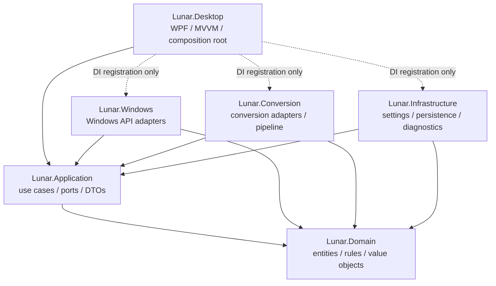
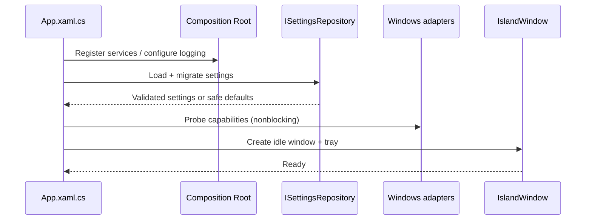

# LUNAR — ARCHITECTURE.md

> **Status:** Normative architecture baseline · **Version:** 1.0 · **Date:** 2026-10-19  
> **Audience:** AI coding agents, maintainers, reviewers, QA, release engineers  
> **Companion:** `PRD.md` (product scope and sprint acceptance criteria)

## 0. Contract for all AI agents (READ FIRST)

This document defines **where code belongs, dependency direction, interface ownership, architectural constraints, and change procedure**. It is not an implementation claim. Read it alongside `PRD.md` before creating, moving, or editing any project file.

**Non-negotiable rules:**
1. Keep dependency direction inward: `Desktop -> Application -> Domain`; adapters (`Windows`, `Conversion`, `Infrastructure`) implement ports defined in `Application` and may reference `Domain`. The `Desktop` composition root may reference adapters **only for DI wiring**.
2. Domain must not reference WPF, Windows APIs, file I/O, logging frameworks, third-party rendering engines, or infrastructure implementations.
3. View and ViewModel code must never directly call P/Invoke, COM, WinRT, `Process.Start`, filesystem conversion engines, or settings storage.
4. Use one composition root, explicit interfaces, constructor injection, typed results, `CancellationToken` and bounded async operations. No `async void` except framework event handlers with guarded exceptions.
5. Never add folders/projects merely for architectural aesthetics. Keep cohesive features together, avoid `Helpers`, `Utils`, `Managers`, `Common` dumping grounds, and premature generic abstractions.
6. Every new file must have a clear owner in the map below. If no owner exists, propose an ADR before introducing a new top-level project or cross-cutting module.
7. Preserve original user files; file conversion is offline and cancellation-aware. Do not persist document contents, Wi-Fi credentials, media history, or PDF passwords.
8. Don't mark work complete without test/build evidence. When running outside Windows, report Windows-specific verification as **not run**.
9. `PRD.md` determines *what* and priority; this file determines *how/where*. In case of conflict, document the discrepancy and request an ADR rather than silently choosing.
10. Any change to public interfaces, dependency direction, file format, settings schema, packaging, or security boundaries requires documentation updates and an ADR where consequential.

## 1. Architecture drivers and quality attributes

- **Maintainability:** feature-oriented organization within clear Clean Architecture boundaries; contracts mockable in tests.
- **Reliability:** disconnected hardware, unsupported OS capabilities, missing media sessions, and failed converters produce explicit recoverable states.
- **Responsiveness:** no long-running work on the WPF UI dispatcher; bounded queues and cancellable background operations.
- **Efficiency:** event-driven OS updates rather than aggressive polling; stop eye animations when hidden/reduced-motion.
- **Security/privacy:** least privilege, local-only conversion, validated untrusted files, isolated temporary directories, safe subprocess invocation.
- **Accessibility:** keyboard, focus, Narrator labels, high contrast, reduced motion, DPI/multi-monitor.
- **Deployability:** reproducible Release build, per-user installer where feasible, opt-in startup, license inventory.

### Architecture style

A **modular monolith desktop app** using Clean Architecture/Ports-and-Adapters and MVVM at the presentation edge. One application process for v1; optional isolated conversion worker only after profiling/security review. No microservices, message broker, database, web backend, or network account is required.

## 2. Dependency map



**Forbidden:** `Domain -> anything`; `Application -> Desktop/Windows/Conversion/Infrastructure`; `Windows -> Desktop`; `Conversion -> Desktop`; `Infrastructure -> Desktop`; adapters depending on one another. Shared coordination happens in Application via ports, not adapter-to-adapter imports.

**Allowed project references (production):**

| Project | Allowed references | Forbidden examples |
|---|---|---|
| `Lunar.Domain` | BCL only | WPF, WinRT, Serilog, file engines |
| `Lunar.Application` | `Domain` | concrete Core Audio service, `Window` |
| `Lunar.Windows` | `Application`, `Domain` | `Desktop`, conversion UI |
| `Lunar.Conversion` | `Application`, `Domain` | WPF, `Windows`, `Infrastructure` |
| `Lunar.Infrastructure` | `Application`, `Domain` | `Desktop`, Windows UI |
| `Lunar.Desktop` | `Application`, `Domain`; adapters for startup DI only | business logic inside XAML code-behind |

> Build pragmatism: `Desktop` necessarily references adapter assemblies to register them; application feature code must still depend only on ports. Keep DI registration in `Composition/ServiceRegistration.cs` and nowhere else.

## 3. Canonical repository map

This tree is a **target layout**, not a claim files already exist. Create directories incrementally with the sprint. Prefer solution file `Lunar.sln` (or `.slnx` if selected in an ADR); use one consistent naming scheme.

Root `ARCHITECTURE.md` is the sole architecture source of truth. `docs/README.md` may link to `../ARCHITECTURE.md`; do not maintain a separate `docs/ARCHITECTURE.md` copy. Sprint 0 code is a temporary feasibility prototype. Official numbered implementation, including BE-01, begins in Sprint 1; BE-01 stays TODO throughout Sprint 0. Reuse requires review, refactoring where needed, and verification against BE-01 acceptance criteria.

Accepted decision update (2026-10-27): [ADR-0001](docs/ADR/ADR-0001-wpf-prototype-boundary.md) selects `Lunar.sln`, the canonical six layers and SDK 10.0.402. [ADR-0004](docs/ADR/ADR-0004-packaging-strategy.md) selects the conditional future `packaging/wix` area for WiX SDK 7.0.0 per-user MSI/self-contained win-x64 multi-file deployment. These are accepted directions, not permission to create the production scaffold or installer before their assigned sprint/task. Tooling terms and release verification remain required.

```text
Lunar/
├── Lunar.sln
├── PRD.md                            # Canonical product requirements
├── ARCHITECTURE.md                   # This architecture contract (single canonical copy)
├── README.md
├── CHANGELOG.md
├── CONTRIBUTING.md
├── LICENSE                           # Only when license decision is made
├── THIRD_PARTY_NOTICES.md
├── .editorconfig
├── .gitattributes
├── .gitignore
├── global.json                       # Pin verified SDK version
├── Directory.Build.props            # Nullable, analyzers, deterministic build, common properties
├── Directory.Packages.props         # Central package management, pinned versions
├── NuGet.Config                      # Only if necessary; no credentials
├── src/
│   ├── Lunar.Domain/
│   │   ├── Lunar.Domain.csproj
│   │   ├── Conversion/
│   │   │   ├── FileFormat.cs
│   │   │   ├── ConversionRoute.cs
│   │   │   ├── ConversionFidelity.cs
│   │   │   └── ConversionPolicy.cs
│   │   └── Shared/
│   │       ├── ErrorCode.cs
│   │       └── Result.cs
│   ├── Lunar.Application/
│   │   ├── Lunar.Application.csproj
│   │   ├── Abstractions/
│   │   │   ├── System/IVolumeService.cs
│   │   │   ├── System/IWifiService.cs
│   │   │   ├── System/IBluetoothService.cs
│   │   │   ├── System/IClock.cs
│   │   │   ├── Media/IMediaService.cs
│   │   │   ├── Conversion/IConversionService.cs
│   │   │   ├── Conversion/IConversionPlanner.cs
│   │   │   ├── Settings/ISettingsRepository.cs
│   │   │   └── Shell/IWindowEnvironment.cs
│   │   ├── System/
│   │   │   ├── Models/VolumeState.cs
│   │   │   ├── Models/WifiState.cs
│   │   │   ├── Models/BluetoothState.cs
│   │   │   └── UseCases/SetVolume.cs
│   │   ├── Media/
│   │   │   ├── Models/MediaSessionSnapshot.cs
│   │   │   ├── Models/MediaCapabilities.cs
│   │   │   └── UseCases/SeekMedia.cs
│   │   ├── Conversion/
│   │   │   ├── Models/ConversionRequest.cs
│   │   │   ├── Models/ConversionPlan.cs
│   │   │   ├── Models/ConversionProgress.cs
│   │   │   ├── Models/ConversionResult.cs
│   │   │   └── UseCases/RunConversion.cs
│   │   ├── Shell/
│   │   │   ├── Models/IslandState.cs
│   │   │   └── UseCases/TransitionIsland.cs
│   │   └── Settings/
│   │       ├── Models/LunarSettings.cs
│   │       └── UseCases/UpdateSettings.cs
│   ├── Lunar.Windows/
│   │   ├── Lunar.Windows.csproj
│   │   ├── Audio/CoreAudioVolumeService.cs
│   │   ├── Network/NativeWifiService.cs
│   │   ├── Bluetooth/WindowsBluetoothService.cs
│   │   ├── Media/GsmtcMediaService.cs
│   │   ├── Environment/WindowsClock.cs
│   │   ├── Environment/MonitorInfoProvider.cs
│   │   ├── Environment/WindowsSettingsLauncher.cs
│   │   └── Interop/                      # Narrow native wrappers, handle ownership
│   ├── Lunar.Conversion/
│   │   ├── Lunar.Conversion.csproj
│   │   ├── Planning/ConversionPlanner.cs
│   │   ├── Pipeline/ConversionOrchestrator.cs
│   │   ├── Pipeline/ConversionJobQueue.cs
│   │   ├── Pipeline/TempWorkspace.cs
│   │   ├── Validation/InputFileValidator.cs
│   │   ├── Validation/ResourceLimits.cs
│   │   ├── Providers/ImageConversionProvider.cs
│   │   ├── Providers/PdfRasterizationProvider.cs
│   │   ├── Providers/PdfCreationProvider.cs
│   │   ├── Providers/DocxEmbeddingProvider.cs
│   │   ├── Providers/LibreOfficeRendererProvider.cs
│   │   └── Output/OutputCommitter.cs
│   ├── Lunar.Infrastructure/
│   │   ├── Lunar.Infrastructure.csproj
│   │   ├── Settings/JsonSettingsRepository.cs
│   │   ├── Settings/SettingsMigration.cs
│   │   ├── Storage/AppDataPaths.cs
│   │   ├── Logging/LoggingConfiguration.cs
│   │   └── Startup/StartupRegistrationService.cs
│   └── Lunar.Desktop/
│       ├── Lunar.Desktop.csproj
│       ├── App.xaml
│       ├── App.xaml.cs                   # Startup / lifetime only
│       ├── Composition/ServiceRegistration.cs
│       ├── Shell/
│       │   ├── IslandWindow.xaml
│       │   ├── IslandWindow.xaml.cs       # View-specific input/window mechanics only
│       │   ├── IslandViewModel.cs
│       │   ├── IslandPositionController.cs
│       │   └── TrayController.cs
│       ├── Features/
│       │   ├── Eyes/
│       │   │   ├── EyesView.xaml
│       │   │   ├── EyesViewModel.cs
│       │   │   ├── EyeAnimationController.cs
│       │   │   └── EyeAnimationState.cs
│       │   ├── System/
│       │   │   ├── SystemPage.xaml
│       │   │   └── SystemPageViewModel.cs
│       │   ├── Media/
│       │   │   ├── MediaPage.xaml
│       │   │   └── MediaPageViewModel.cs
│       │   └── Converter/
│       │       ├── ConverterPage.xaml
│       │       └── ConverterPageViewModel.cs
│       ├── Navigation/
│       │   ├── SwiperController.cs
│       │   └── PageNavigationViewModel.cs
│       ├── Controls/                       # Reusable UI primitives only
│       ├── Behaviors/                      # Reusable attached WPF behaviors
│       ├── Themes/
│       │   ├── Colors.xaml
│       │   ├── Typography.xaml
│       │   ├── Spacing.xaml
│       │   └── Components.xaml
│       ├── Resources/                      # Icons / localization / fonts if licensed
│       └── Accessibility/                  # Accessibility-specific adapters/helpers
├── tests/
│   ├── Lunar.Domain.Tests/
│   ├── Lunar.Application.Tests/
│   ├── Lunar.Windows.IntegrationTests/
│   ├── Lunar.Conversion.Tests/
│   ├── Lunar.Infrastructure.Tests/
│   └── Lunar.Desktop.UITests/
├── docs/
│   ├── ADR/
│   │   ├── 0001-modular-monolith-wpf.md
│   │   ├── 0002-windows-api-capability-fallbacks.md
│   │   └── 0003-conversion-provider-strategy.md
│   ├── API_CONTRACTS.md
│   ├── CONVERSION_MATRIX.md
│   ├── SECURITY.md
│   ├── PRIVACY.md
│   ├── COMPATIBILITY.md
│   ├── DESIGN_TOKENS.md
│   ├── TEST_PLAN.md
│   ├── TEST_REPORT.md
│   ├── RELEASE_CHECKLIST.md
│   └── USER_GUIDE.md
├── packaging/
│   ├── wix/                             # Installer sources, if WiX is selected
│   └── assets/
├── scripts/
│   ├── build.ps1
│   ├── test.ps1
│   └── package.ps1
└── .github/
    ├── workflows/ci.yml
    └── pull_request_template.md
```

**Naming:** project/namespace match (`Lunar.Application.Media`), interfaces start `I`, `*ViewModel` for UI state, `*Service` for external capability implementations, `*Repository` for storage, `*Provider` for conversion backend, `*UseCase` or descriptive action for orchestration. One public type per file as a default, not a rigid rule. Folder names use PascalCase; docs and scripts follow their ecosystem conventions.

## 4. Responsibilities and boundaries

### 4.1 Domain
Pure immutable concepts and business rules: supported file formats, route eligibility, fidelity classifications, error categories, and deterministic conversion policy. Domain validates *rules*, not physical files. Avoid an anemic collection of interfaces without meaningful rules; small types are fine.

### 4.2 Application
Owns use cases, capability-neutral contracts (ports), request/response DTOs, cross-feature orchestration and policies. Uses structured `Result<T>` or documented typed failures for expected failures; exceptions for unexpected faults. UI-specific state does not belong here unless it is a platform-independent shell state machine. Do not leak COM/WinRT/WPF types across ports.

### 4.3 Windows adapters
Wrap OS APIs: Core Audio, Native Wi-Fi, Bluetooth/radios, GSMTC, monitor/DPI, settings URI launcher. Map native errors to stable application error codes. Implement subscription lifetime and disposal, native handle cleanup, COM apartment and WinRT initialization requirements. Treat capability discovery separately from action success. Platform-dependent APIs must be probed on supported Windows versions.

Accepted ADR-0003 places native Windows PDF rasterization in a Windows adapter implementing an Application-owned port; no WinRT PDF type crosses that port.

### 4.4 Conversion adapters
Own validation of untrusted input, route providers, queue, temporary workspace, external renderer invocation, output staging and atomic finalization where possible. Conversion orchestration can live in `Conversion` if purely technical; user-facing conversion policy and planning contracts remain in `Application`/`Domain`. Providers do not directly call other providers; orchestrator composes stages.

Under accepted ADR-0003, `PdfRasterizationProvider` coordinates through the Application rasterization port. Desktop wires the Windows engine; Conversion must not reference Windows. Exact port signatures/lifetimes still require review before BE-04/BE-24 implementation. The disposable converter CLI is not a production adapter to copy unchanged.

### 4.5 Infrastructure
Local JSON settings, schema migration, application directories, structured logging configuration, startup registration. No document content stored. Centralized app data path rules; no hard-coded `C:\Users\...` paths.

### 4.6 Desktop
Only WPF view rendering, user interactions, navigation, accessibility, animation and view state. ViewModels invoke application ports/use cases. XAML code-behind is permitted for inherently visual operations (window positioning, drag input, focus, animations) and must not contain business rules. UI dispatcher is the only thread that mutates bound UI collections/properties.

## 5. Feature mapping: what goes where

| User action / behavior | Desktop | Application/Domain | Adapter |
|---|---|---|---|
| Blink/gaze/click eyes | `Features/Eyes` rendering and animation | Pure eye state transitions if shared/testable | No OS dependency required |
| Expand/collapse island | `Shell`, `Navigation` | `Shell/TransitionIsland` state transitions | Windows environment/monitor adapter |
| Change master volume | `SystemPageViewModel` | Volume port + command | `Windows/Audio` Core Audio |
| Show date/time | `SystemPageViewModel` | `IClock` abstraction | Windows/system clock implementation |
| Wi-Fi/Bluetooth | `SystemPageViewModel` | Status/capability contracts | `Windows/Network`, `Windows/Bluetooth` |
| Now playing/seek | `MediaPageViewModel` | Session models, `SeekMedia` | `Windows/Media` GSMTC |
| Select conversion | `ConverterPageViewModel` | Conversion graph/policy/plan | `Conversion/Planning` |
| Execute conversion | `ConverterPageViewModel` | `RunConversion`, progress contract | `Conversion/Pipeline` and providers |
| Save preferences | Settings view/viewmodel | Settings model and port | `Infrastructure/Settings` |
| Tray and startup | `Shell/TrayController` | Shell/startup contracts | Windows startup adapter |

**Placement decision tree:** Is it visual/WPF? → Desktop. Is it a rule independent of Windows? → Domain. Is it an application command or interface? → Application. Does it call Windows API? → Windows. Does it process/transform files? → Conversion. Does it persist/configure/log? → Infrastructure. If multiple apply, split orchestration from adapter, do not cross-import.

## 6. Contracts and data shapes

Keep interfaces small and capability-oriented. These are **illustrative** signatures, to be reconciled with the PRD and ADR before coding:

```csharp
public enum CapabilityStatus { Supported, Unsupported, PermissionDenied, Unavailable, Unknown }
public enum ErrorCode { Unsupported, AccessDenied, DeviceUnavailable, InvalidInput, Cancelled, Timeout, DependencyMissing, IoFailure, Unexpected }
public sealed record OperationError(ErrorCode Code, string SafeMessage, bool Retryable = false);
public sealed record OperationResult(bool Success, OperationError? Error = null);

public interface IVolumeService : IAsyncDisposable
{
    Task<VolumeState> GetAsync(CancellationToken ct);
    Task<OperationResult> SetVolumeAsync(float scalar, CancellationToken ct);
    Task<OperationResult> SetMuteAsync(bool mute, CancellationToken ct);
    IObservable<VolumeState> Changes { get; }
}

public interface IMediaService : IAsyncDisposable
{
    Task<IReadOnlyList<MediaSessionSnapshot>> GetSessionsAsync(CancellationToken ct);
    Task<OperationResult> SeekAsync(string sessionId, TimeSpan position, CancellationToken ct);
    IObservable<MediaSessionSnapshot> Changes { get; }
}

public interface IConversionService
{
    Task<ConversionResult> ExecuteAsync(ConversionPlan plan,
        IProgress<ConversionProgress> progress, CancellationToken ct);
}
```

The interface examples are not an instruction to duplicate contracts already defined in `PRD.md`. Normalize naming (`IWifiService` vs `INetworkService`) through ADR 0002 and update both docs. Avoid exposing `BitmapImage`, `Window`, `StorageFile`, COM handles or native pointers in application contracts. Represent artwork as a bounded byte stream/DTO owned by the adapter, with explicit disposal and size limits. Never pass raw file paths to log statements unless sanitized/redacted.

ADR-0002 was accepted on 2026-10-27: normalized names are `IWifiService` and `MediaSessionSnapshot`, with typed command results and separate planner/executor strategy. Examples here/PRD remain illustrative until exact production signatures, read-result/cancellation and replay/threading/disposal semantics are reviewed in BE-04. No implemented or versioned public contract is accepted by these examples alone.

### Event/subscription model
- Prefer OS change notifications for volume/media/device state.
- UI subscriptions are disposed on ViewModel deactivation/window close; use weak events only when appropriate, not as a substitute for lifecycle design.
- Use `IObservable<T>` only with documented threading, replay and error semantics; otherwise a typed event or async stream is acceptable.
- Debounce seek/volume UI updates and guard against feedback loops. User dragging a seek slider owns its thumb state until release.
- For media artwork, cancel stale loads on session switch.

## 7. Runtime flows

### 7.1 App startup and lifetime



Startup rules: single-instance policy with documented activation behavior (named mutex/IPC only if needed); no privileged elevation; catch/log fatal startup errors without infinite restart loops. Initialize UI quickly, load expensive capability probes asynchronously. On exit cancel operations according to policy, dispose subscriptions, remove tray icon, and clean orphaned temp jobs safely.

### 7.2 Volume interaction
`Slider -> SystemPageViewModel -> application command/IVolumeService -> CoreAudioVolumeService -> Windows endpoint`; OS callback flows back through service state stream to ViewModel, marshalled to dispatcher. Optimistic slider state rolls back if rejected. Handle endpoint disappearance.

### 7.3 Media seek
`PointerDown -> drag-lock -> update preview mm:ss -> PointerUp -> SeekMedia -> IMediaService -> GSMTC TryChangePlaybackPositionAsync -> refresh authoritative position`. Clamp against reported valid timeline; reject zero/unknown/live/nonseekable timeline. UI must not claim success until OS reports it.

### 7.4 Conversion transaction

```mermaid
flowchart LR
  Input[File picker / drop] --> Validate[Validate signature, size, path, limits]
  Validate --> Plan[Route planner + fidelity warning]
  Plan --> Queue[Bounded queue]
  Queue --> Stage[Per-job isolated temp workspace]
  Stage --> Provider[Conversion provider(s)]
  Provider --> Verify[Verify output integrity]
  Verify --> Commit[Conflict policy + final output commit]
  Commit --> Cleanup[Cleanup temp / report result]
```

**Transaction invariants:** input files are opened read-only; never modify originals; staging directory is unique per job; output name is sanitized and cannot escape destination; collision policy is explicit; finalization uses a safe move/copy strategy (atomic rename only where supported and same-volume); cancellation/failure removes incomplete staging output; retain no secrets. Partial successful batch results are explicitly reported, never silently hidden.

### 7.5 DOCX / PDF boundaries
- PNG/JPG/JPEG conversions use reviewed image provider; JPEG/JPG same encoding.
- Image→DOCX means embedding an image, **not OCR**.
- DOCX→PDF and DOCX→images require optional installed document layout engine (e.g. LibreOffice), capability-detected, with isolated profile, timeout and safe argument passing (`ArgumentList`, no shell concatenation).
- PDF→images is per-page rasterization with DPI/page/memory caps.
- PDF→DOCX is **not a v1 release gate**; any future provider needs an ADR and explicit fidelity labeling.
- No macro execution, embedded script execution, remote fetching or document upload.

## 8. State management and concurrency

### Island state machine

| Current | Event | Next | Notes |
|---|---|---|---|
| Idle | Click | Expanded | One active expansion animation |
| Idle | Hover | Idle | Visual eye reaction only |
| Expanded | Escape/outside click | Idle | Respect dialog/focus/drag guards |
| Expanded | Start conversion | Expanded/Busy indicator | Job continues after collapse |
| Expanded | Switch page | Expanded | Retain stable page VM state |
| Any visible | Recoverable failure | Current + inline error | Do not force global Error state |
| Any | Exit | Closing | Cancel/settle operations and dispose |

Prefer a single `IslandViewModel` owner for shell state and one `PageNavigationViewModel` for selected page. No global mutable singleton state bag. ViewModels expose immutable snapshots or observable properties. UI changes on Dispatcher; heavy file work on background tasks; no `Task.Run` wrapping naturally async OS calls just to appear asynchronous. Limit conversion concurrency (default 1 active document-heavy job; configurable after benchmarks). Use `SemaphoreSlim` or `Channel<T>` with bounded capacity and explicit shutdown behavior. Never use blocking `.Result`, `.Wait()`, or fire-and-forget tasks without an owned lifecycle.

### DI lifetime guidance
- Singleton: stateless app-wide OS services and settings repository when thread-safe; main shell coordinator; logging configuration.
- Transient: short-lived use cases, per-job converters where stateful, dialogs.
- Per-window/page: ViewModels created/owned by window scope or explicitly disposed on close.
- Per-conversion job: workspace, cancellation source, progress, temporary resources.
- Every singleton subscribing to OS events must implement proper disposal.

## 9. Windowing, DPI and accessibility constraints

- WPF window uses borderless transparent rendering, no fullscreen overlay; work-area-aware top-center placement.
- Support per-monitor DPI awareness and monitor changes; distinguish device-independent pixels (DIP) from physical pixels.
- Hit-testing only within island content; avoid accidental invisible blocking regions.
- Non-activating behavior may conflict with keyboard navigation; test focus acquisition explicitly and document chosen behavior.
- Respect fullscreen games/video, taskbar changes, sleep/resume and RDP sessions.
- Reduced-motion preference overrides continuous gaze animations; focus order, accessible names and Narrator must work in all three pages.
- Animations should be storyboard/compositor-driven where feasible, with no perpetual UI-thread busy loop.

## 10. Error handling, diagnostics and privacy

**Expected errors** (unsupported radio toggle, no media session, corrupted file, missing renderer) return typed recoverable results with safe user messages. **Unexpected exceptions** are caught at service boundaries and top-level crash handling, logged with context but without personal data, and surfaced appropriately. Never swallow exceptions or return `Success=true` after a failed OS call.

Recommended structured log fields: timestamp, event ID, component, operation, duration, result/error code, OS build (if privacy policy allows), app version. Do not log SSIDs, media titles, user file names/paths, document content, passwords or sensitive raw exception messages by default. User diagnostic export must be explicit and reviewable. Store logs under `%LocalAppData%/Lunar/Logs` with rotation and retention policy documented in `docs/PRIVACY.md`.

Security controls: least privilege, file type sniffing, file size/page/pixel limits, DOCX zip bomb defenses, XML parser hardening, symlink/reparse-point handling, safe output paths, no untrusted shell interpolation, signed releases when possible, dependency CVE and license review. Threat model in `docs/SECURITY.md` before converter release.

## 11. Settings schema and migration

`%LocalAppData%/Lunar/settings.json` contains a `schemaVersion`, typed preferences (startup, position, theme, animations, locale, converter defaults), and no credentials or file contents. Save atomically using write-to-temp + flush + replace/rename strategy with backup where feasible. Validate on read; corrupted file falls back to safe defaults and recoverable notice. Each breaking schema change gets a deterministic migration with fixture tests. Application owns `LunarSettings`; Infrastructure owns serialization/migration.

Example **illustrative** schema:

```json
{
  "schemaVersion": 1,
  "launchAtStartup": false,
  "island": { "anchor": "TopCenter", "monitor": "Primary", "offsetX": 0, "offsetY": 8 },
  "appearance": { "theme": "Dark", "reduceMotion": false, "eyeAnimationEnabled": true },
  "media": { "preferredSessionId": null },
  "conversion": { "outputDirectory": null, "defaultPdfDpi": 150 }
}
```

## 12. Testing strategy and architecture fitness functions

| Test layer | Project | Main responsibility | Environment |
|---|---|---|---|
| Domain unit | `Lunar.Domain.Tests` | conversion routes, policies, invariants | Any supported .NET host |
| Application unit | `Lunar.Application.Tests` | use cases, error propagation, shell state, cancellation with fakes | Any supported .NET host |
| Windows integration | `Lunar.Windows.IntegrationTests` | Core Audio, Wi-Fi/Bluetooth, GSMTC, DPI | Actual Windows + relevant hardware |
| Conversion tests | `Lunar.Conversion.Tests` | golden files, corruption, limits, cancellation, temp cleanup | Windows for optional external renderer |
| Infrastructure tests | `Lunar.Infrastructure.Tests` | settings migrations, atomic save, log redaction | Any supported .NET host |
| Desktop UI tests | `Lunar.Desktop.UITests` | keyboard, swipe, focus, DPI, Narrator manual/automation | Interactive Windows session |

**Fitness checks (enforce in CI):**
1. `dotnet restore`, `dotnet build -c Release`, `dotnet test -c Release` (with environment-specific Windows gates).
2. Architecture tests validate project references and forbidden namespace dependencies. Use an approved architecture test library or reflection-based checks; never add unreviewed packages.
3. Nullable reference types enabled; warnings and analyzers triaged; no newly introduced high-severity warnings.
4. Format validation with `dotnet format --verify-no-changes` where configured.
5. Unit tests for all new application rules; integration tests or explicitly marked manual cases for Windows-specific behavior.
6. Security regression: path traversal, corrupted DOCX/PDF, zip bombs, huge pages, cancellation, temp cleanup, disk full, dependency missing.
7. Resource regression: idle CPU/RAM, animations, conversion memory on Windows Release build.

CI should use Windows runners for the WPF solution. Never claim a Linux/macOS build proves WPF or COM functionality. CI workflows must not require hardware-dependent tests to pass on a headless runner; classify them as manual/hardware-gated and record evidence separately.

## 13. Dependency and package governance

Use central package management with `Directory.Packages.props` and pin versions; do not guess versions. Record third-party license, redistribution terms, native binaries, CVEs and maintenance status in `THIRD_PARTY_NOTICES.md`. WPF/MVVM, Core Audio, GSMTC, image/PDF, Open XML, and optional LibreOffice integrations must each be validated in Sprint 0. Prefer small maintained dependencies. No reflection-heavy plugin framework for v1; conversion providers can be registered through explicit DI.

## 14. Build, packaging, and deployment

- Pin SDK via `global.json` after verification; use `net10.0-windows` and WPF settings in desktop project where compatible.
- Decide `win-x64` packaging, framework-dependent vs self-contained and installer strategy via ADR. Don't publish both without testing.
- `scripts/build.ps1`: restore + Release build; `scripts/test.ps1`: test + reports; `scripts/package.ps1`: publish + installer + notices; scripts fail on nonzero exit codes.
- Per-user installation by default if feasible; do not elevate for normal runtime.
- Opt-in startup registration, clean uninstall, predictable data retention prompt, version metadata, integrity/signature verification if signing is configured.
- No automatic updates in v1 unless explicitly scoped and security-reviewed.

## 15. Documentation and ADR governance

**Source of truth:** `PRD.md` = requirements; `ARCHITECTURE.md` = module boundaries/file ownership; `docs/API_CONTRACTS.md` = detailed port signatures; `docs/CONVERSION_MATRIX.md` = supported routes; `docs/ADR` = decisions with rationale; `docs/TEST_REPORT.md` = observed evidence. Avoid contradictory duplicate documents.

ADR template:

```md
# ADR-XXXX: Decision title
Status: Proposed | Accepted | Superseded
Date: YYYY-MM-DD
Context: What problem and constraints?
Decision: What is selected?
Alternatives: What was rejected and why?
Consequences: Benefits, costs, risks, migration impact.
Validation: Tests/spikes proving feasibility.
```

Create ADR for: UI technology switch, Windows API strategy, conversion provider licensing, subprocess isolation, major settings schema, plugin architecture, installer choice, or architecture boundary changes. An ADR does not override PRD scope without explicit agreement.

## 16. Agent workflow for every sprint / feature

**Before coding:**
1. Read `PRD.md`, `ARCHITECTURE.md`, related ADRs, relevant contracts and existing code.
2. Restate the exact sprint/feature scope and acceptance criteria.
3. Map proposed new/modified files to the canonical tree and list project dependencies.
4. Identify OS, hardware, security, licensing, and test constraints; record unknowns.
5. If architecture change is required, propose an ADR first.

**During coding:**
1. Implement vertical slices (port + use case + adapter + VM + view + tests) rather than disconnected placeholder files.
2. Preserve boundaries, cancellation, disposal, capability fallbacks, accessible UI and user data safety.
3. Prefer minimal patches; do not reorganize unrelated code or add speculative infrastructure.
4. Add tests and documentation with implementation, not after a large unverified batch.

**After coding:**
1. Run the relevant restore/build/test/format commands and capture exact output, OS and SDK versions.
2. Report files added/changed, architecture compliance, acceptance criteria pass/fail/unverified, known limitations and manual Windows test steps.
3. Update ADRs/contracts/conversion matrix/changelog as applicable.
4. Stop at the sprint gate; don't silently start the next sprint.

### Standard agent completion report

```md
## Implemented
- Feature / acceptance criteria:
- Files added or modified:
- Dependency changes and licenses:
## Verification
- OS / SDK:
- Commands executed and results:
- Manual Windows checks (pass/fail/not run):
- Architecture rule checks:
## Risk and follow-up
- Known limitations:
- Security/privacy impact:
- Proposed ADRs or deviations:
- Ready for sprint gate: yes/no (with evidence)
```

## 17. Sprint-to-module mapping

| Sprint | Allowed primary areas | Required architectural output |
|---|---|---|
| 0 Discovery | `docs/ADR`, `docs/COMPATIBILITY`, prototype `Desktop`/`Windows` | Windows API feasibility, dependency/license evidence, initial contracts |
| 1 Shell | `Desktop/Shell`, `Application/Shell`, `Infrastructure/Settings` | state machine, DI, settings persistence tests |
| 2 Eyes | `Desktop/Features/Eyes` | lifecycle-safe animation and deterministic test seam |
| 3 Swiper | `Desktop/Navigation`, `Themes`, `Controls` | navigation/focus/gesture tests |
| 4 System | `Application/System`, `Windows/Audio/Network/Bluetooth` | ports, adapters, capability/error mapping |
| 5 Media | `Application/Media`, `Windows/Media`, `Desktop/Features/Media` | seek contract, event lifecycle and unsupported states |
| 6 Converter | `Domain/Conversion`, `Application/Conversion`, `Conversion/*`, converter UI | route graph, safe pipeline, golden-file/security tests |
| 7 Release | `tests`, `docs`, `packaging`, `scripts`, `.github` | QA evidence, installer, notices, release checklist |

## 18. Anti-patterns (reject in review)

- One 1,000-line `MainWindow.xaml.cs` controlling all pages and calling OS APIs.
- ViewModel directly imports `Windows.*`, `System.Runtime.InteropServices`, or third-party PDF rendering APIs.
- Generic `ServiceLocator.Instance` or mutable global state accessed from every module.
- Converter calls `Process.Start("cmd.exe", "/c ...")` with user-provided filenames.
- A fake progress bar that reaches 100% without verifying output.
- Blocking the dispatcher while rendering a PDF or enumerating media sessions.
- Catch-all `catch { }` that hides failures.
- Logging full file paths, Wi-Fi SSIDs, song titles, or PDF passwords.
- A single `Helpers` folder containing unrelated code.
- Silent overwrite of user files or temporary files left after cancellation.
- Introducing cloud dependencies, database, or a backend without a requirement and ADR.
- Creating dozens of empty files/classes to match the tree before their sprint.

## 19. Architecture acceptance checklist

- [ ] Each source file has one clear module owner.
- [ ] Project references match Section 2; no forbidden namespace dependencies.
- [ ] Business rules and OS-specific implementations are separated.
- [ ] ViewModels contain no OS interop, direct conversion or persistence calls.
- [ ] Dependencies are injected, scoped and disposed appropriately.
- [ ] Async flows are cancellable; no UI blocking or unmanaged event leaks.
- [ ] Capability fallbacks and typed failures exist.
- [ ] Conversion never mutates original inputs; output is validated.
- [ ] Sensitive data is absent from logs and settings.
- [ ] Unit/integration/UI verification is recorded honestly.
- [ ] Docs/ADRs/package notices are updated when impacted.

---

## 20. Agent execution governance and task ownership (v1.1)

`AGENTS.md` is the mandatory execution entry point. `PRD.md` defines feature scope; this document defines architectural ownership; `FE_TASK.md` and `BE_TASK.md` contain immutable implementation IDs (26 FE and 30 BE). Read all relevant files before work. Sprint 0 is a prerequisite technical spike tracked in `docs/SPRINT_STATUS.md`; numbered FE/BE tasks cover Sprints 1–7. Never create duplicate task IDs.

**File ownership:** FE tasks primarily own `src/Lunar.Desktop/` presentation files and UI tests; BE tasks primarily own `Lunar.Domain`, `Lunar.Application`, `Lunar.Windows`, `Lunar.Conversion`, `Lunar.Infrastructure`, platform tests, build/packaging scripts. Shared contracts in `Lunar.Application`, the composition root, project files, CI, and documentation are *coordination surfaces*: declare intended changes before editing and assign a single integrator. FE must use ports and test fakes rather than adding OS calls; BE must not alter presentation design unilaterally.

**Concurrency:** two agents may work simultaneously only on non-overlapping files with a stable agreed interface. For shared files, serialize edits or use separate branches/worktrees and an explicit integration owner. Before merging, verify dependency direction, contracts, build, tests, and UX integration. An agent must not overwrite another agent's uncommitted changes.

**Evidence and status:** each task completion requires a file list, exact build/test commands and exit codes, Windows manual checks or explicit `NOT_RUN`, test artifacts, residual risks, and a status transition recorded in `docs/SPRINT_STATUS.md`. A sprint may advance only after human approval. Treat blocked Windows validation as a blocker for the relevant gate, not as passed verification.

**Architecture fitness gates:** reject forbidden project references, UI-thread blocking conversion/COM calls, native calls in ViewModels, unmanaged resource leaks, noncancellable long-running work, unvalidated paths, silent network activity, secret/document-content logging, and conversion claims not supported by tests. Enforce through project-reference tests, automated tests, static checks, and manual Windows acceptance as appropriate.

## 21. Ready-to-paste AI agent architecture prompt

> You are the principal Windows desktop architect and senior C# engineer for Lunar. Treat `ARCHITECTURE.md` as the mandatory file/folder ownership and dependency contract, and `PRD.md` as the product scope and acceptance source. Before coding, inspect the repository and map every planned file to the canonical architecture. Follow modular monolith + Clean Architecture + WPF MVVM; Domain is pure, Application owns ports/use cases, Windows/Conversion/Infrastructure are adapters, Desktop owns presentation and the DI composition root. Never place native Windows calls, document conversion, or settings persistence inside ViewModels or XAML code-behind. Create only files needed for the current sprint; don't generate empty scaffolding. Use capability-aware Windows services, typed failures, cancellation, deterministic state transitions, secure offline conversion and resource cleanup. Write tests and record exact commands and outcomes. If the requested change breaks the architecture, explain it and propose an ADR before proceeding. When done, report changed files, dependency graph compliance, tests actually run, manual checks still needed, security/licensing concerns, and sprint gate status. Do not begin the next sprint without approval.

**Document maintenance:** This is a living architecture baseline. Update it through reviewed, documented changes; never treat the example tree as a reason to over-engineer.
